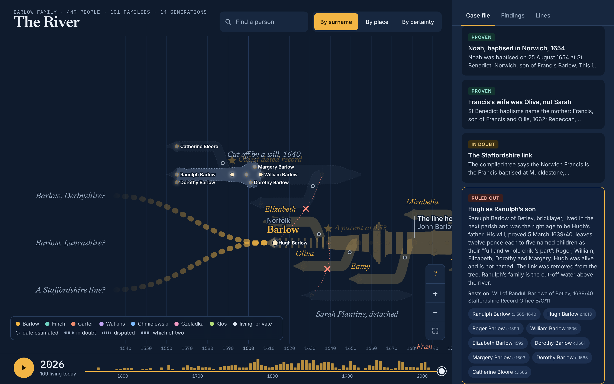
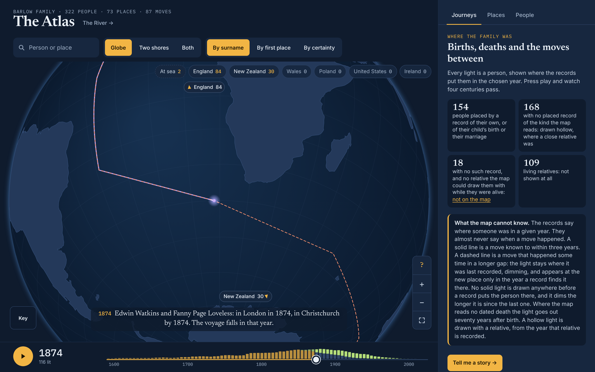
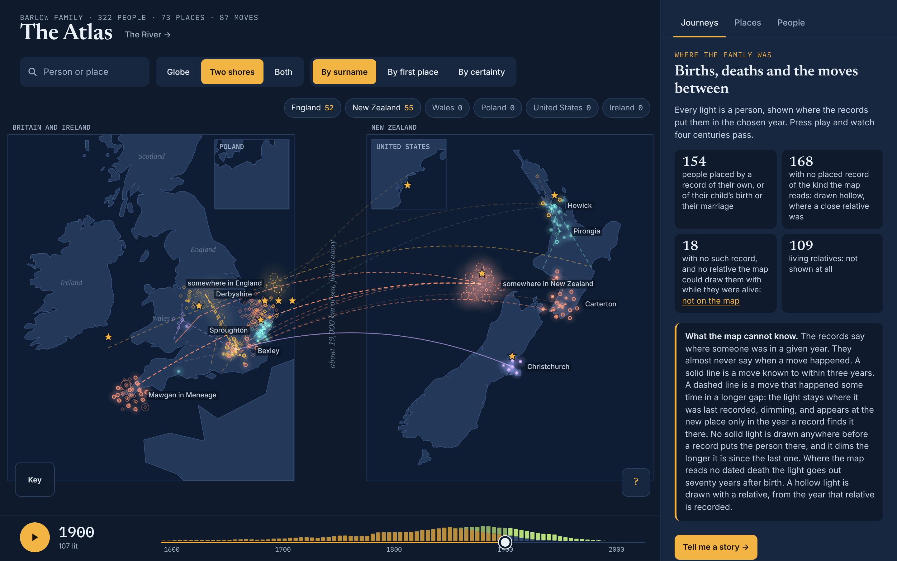

# The River

An interactive exploration of the Barlow family tree. Fourteen generations drawn as streams that join at each marriage, with a case file beside it for the one question the tree cannot yet answer: where did the Norwich Barlows come from?

Status: built and working. Data is a snapshot exported from Iris on 18 November 2026.


## Run it

```bash
npm install
```

```bash
npm run dev
```

Then open the address it prints. `npm run build` writes a static site to `dist/` that can be hosted anywhere.

## What you can do

1. **Scrub the year.** Drag the year on the river or the track below it, or press play (space bar). People light up when born and go dark when they die. The river ahead of the year is shown faintly, people included, and tapping one takes you to their year.
2. **Tap a person.** Their record opens: dates, places, photo, sources, research notes, family, and their life in a few sentences worked out from the people around them ("The 2nd of 7 children on record. Married at 24. Outlived Elizabeth Short by 17 or 18 years."). Ages count birthdays, so two bare years give "17 or 18". Their ancestors and descendants light up. "Follow the water" sends a pulse from them downstream to the present.
   - **Related to…** Pick any second person and it says how the two are connected: "3rd cousin once removed", or step by step through marriages when there is no shared blood.
   - **Namesakes.** There are twelve Peter Barlows. One tap lights them all.
   - **What rests on a link.** Every link to parents says how many ancestors depend on it. For a doubted link: "If this link is wrong, 2 people upstream, back to 1612, are not this family's."
3. **Switch the lens.** By surname, by place, or by certainty (keys 1, 2, 3).
4. **Open the case file.** Nine evidence cards, ruled out, in doubt or proven. Tapping one moves the river there and lights the people and the water it bears on. "Walk the evidence" steps through them upriver.
5. **Read the findings.** Counted from the tree by rule, and the ones that belong to a place are starred on the river itself. What it shows: the river reaches New Zealand in 1855, one couple had 14 children, 14% of people cite a record. And what is worth a second look: a parent who would have been 15, a name given twice in six families, people marked living in a generation born before 1921.
6. **Add a piece of evidence.** A draft card, saved in your browser only. It produces a change request to apply in Iris. The site never writes to the tree.

Also: search by name (`/`), zoom and pan, deep links (the address bar carries the year, person, lens and card), and a short guide behind the `?` button.

On a wide screen, play starts close on the headwaters and pulls back as the river grows. On a phone the camera travels with the year.



## The Atlas: the same tree on the Earth

A second mode, at `atlas.html`. The River shows time and doubt. The Atlas adds place. Brief: `BRIEF-ATLAS.md`.



1. **Press play.** A light comes on where each person was born and goes out when they die. Every light leaves a mark: an ember where a death or burial names the place, a small open diamond otherwise. Captions tell the moves as their years come, and count the lights in the quiet years. The camera follows the family, and turns to the other side of the world when it goes there. The last frame sits close on New Zealand and counts what each country remembers.
2. **Two ways to draw the Earth, or both.** A globe, and two shores: Britain and New Zealand drawn large with the ocean folded away, and small insets for Poland and the United States. On a wide screen, globe and shores side by side (keys G, S, B). The globe's camera stays with the family in Europe, crosses to New Zealand once, with the one voyage the records date closely, and stays there.
3. **Tap a light.** The places the records put that person, in order, each with the evidence: born, baptised, census, married, the birth of a child, buried. Then each move, with the years it could have happened in. "Follow the journey" plays that one life. "Light the family" lights parents, brothers and sisters, partners and children together. An ember or a diamond can be tapped too: it opens the person it remembers.
4. **Tap a place.** Who was born there, who died there, who is only recorded there, and from when to when. A strip of bars shows how many lights stood there in each decade, with the most in any year. Tap a bar to go to that year and see who was there, who was new and how many had gone. Country panels have the same strip, and their count follows the year.
5. **See every country.** A row above the map names each country in the records and counts the lights lit there that year: England, New Zealand, Wales, Poland, Ireland, the United States, and anyone at sea. On the globe, a country out of view is named at the rim in the direction it lies. Tap either to go there and see who it was.
6. **Switch the lens.** By surname, by the first place each person is drawn, or by how well the place is known.
7. **Stars on the map.** A finding that belongs to a place is starred there from the year it happens. Tap it to read it.
8. **Read the findings.** Sixteen things counted from the records and two worth a second look. Among them: the first of the family in New Zealand, fourteen people recorded on both sides of the world and no record of anyone coming back, the life that ended farthest from where it began, a silence of 93 years between two records, the oldest person a record places in New Zealand, how many of the people drawn are borrowed in each century, a couple on both sides of the world in one year, and a move the tree itself doubts. "Tell me a story" steps through them in the order of their years. The finding about the 1874 voyage has a "Sail with" button that rides the ship.



What it will not pretend to know:

- **A solid light has a record.** It is never drawn anywhere before a record puts the person there, and it dims the longer it is since the last one. A hollow light has no dated, placed record of the kind the map reads: the person is drawn where a close relative with a record of their own was last recorded, never earlier than that relative's first record. A child drawn with a parent goes where that parent is next recorded, until sixteen; otherwise a hollow light never moves. A haze is a place known only to a county or country; a country is drawn just offshore, marked "somewhere in". Eighteen people have none of the records the map reads, and no relative the map could draw them with while they were alive. They are listed, not drawn.
- **A loose year stays loose.** Where the record says "c. 1823", the page says "about 1823", gives the age as "about", and never draws a voyage as sailing on it.
- **When a move happened is almost never recorded.** Where the records pin it to within three years, the light travels. Otherwise it stays where it was last recorded and appears at the new place only in the year a record finds it there.
- **Sea routes are custom, not record.** A voyage to New Zealand is drawn the way ships went at the time: out round the Cape of Good Hope, and through Panama once the canal had opened. The line is not the course of any one ship; where a note in the tree names a ship, it is in that person's record in the River.
- **What stays after a light goes out.** Where a death or burial names a town or parish, an ember. Otherwise a small open diamond at the last place the map has for the person, which does not say they died there.
- **Living people are not on the map.** No light, no place.

How it is made: `pipeline/gazetteer.ts` places every place name in the tree by hand, so no family data is sent to a geocoding service. `pipeline/atlas.ts` builds `public/data/atlas.json` from the published `river.json`, never from the raw export, so the Atlas cannot publish anything the River does not. Anyone who died from 1950 on is shown to the town only. The basemap is Natural Earth, bundled (`scripts/build-land.ts` writes it, coarse for the world and detailed for Britain, Ireland and New Zealand); nothing is fetched from a map service.

## How the river is drawn

This replaces the mockup's illustrative joins with real ones.

- **The river is the ancestry of the youngest generation.** Each direct ancestor's line is a stream. Each ancestral marriage is a place where two streams join, drawn at the year of the marriage. Where the marriage year is not recorded it is estimated from the first child.
- **The Barlow line is the trunk.** The other six named lines join it. Smaller springs (Din, Blomfield, Short, Julian, Seaman and about forty more) feed the line they marry into and take its colour.
- **Everyone else rides in the stream of the ancestors they descend from.** The water is as wide as the number of people alive in it that year.
- **Doubt is drawn.** Solid water has a source behind it. Dashed water is a link the tree itself calls a hypothesis. Dotted water is disputed. A flag marks how far up the trunk the evidence runs without a break: ten generations, to John Barlow the worsted weaver.
- **What was ruled out is cut off.** Ranulph Barlow's family, once thought to be Hugh's parents, sits above the river as an oxbow lake with the link crossed through.
- **Before Hugh, three guesses.** The trunk rises from three ghost headwaters: Barlow in Derbyshire, Barlow in Lancashire, or a local Staffordshire line.

## Privacy

The tree holds 109 living people. The rule is enforced when the data file is built, so nothing private ever reaches the page.

- A living person is stored as an opaque id, their links, and a position estimated from their relatives to the nearest decade. No name, date, sex, surname, place or text.
- `is_deceased` decides. A record with no flag counts as living unless it carries a date more than 120 years old.
- Marriages with a living partner have no date.
- Notes and descriptions are published only for people born before 1900 or dead before 1950, and any text that names a living person (by full name, or by a first name only living people have) is dropped.
- The raw Iris export is never committed. `data/raw/` is in `.gitignore`.

`npm test` checks all of this, including a scan of the published file for every living person's name when the raw export is present. The tests also run on every push.

What still shows: the shape of the tree. An unnamed light sits under its named, deceased parents. Decide whether that is acceptable before sharing the link beyond the family.

## Refreshing the data

1. Export the set from Iris: `export_set(set_id="4a2f4562-c930-4fb8-a2cc-0862e6f040bf", format="json")`. Save the result as `data/raw/iris-export.json`.
2. Run the build and the tests:

```bash
npm run data
```

```bash
npm test
```

3. Commit `public/data/river.json` and `public/data/atlas.json`. `npm run data` builds both. If a record in the tree has a place name the gazetteer does not know, the build stops and lists it: add it to `pipeline/gazetteer.ts`. A place named only in a person's free-text description is skipped when it cannot be placed.

The case file cards in `src/casefile.ts` are written by hand from the Iris document "Hypothesis: the original Barlow village". When that document changes, update the cards. A test fails if a card points at someone who is no longer in the tree.

## What is here

| Path | What it is |
|---|---|
| `BRIEF.md` | The original build brief |
| `pipeline/` | Iris export to `public/data/river.json`: dates, places, certainty, privacy, leads |
| `src/model/layout.ts` | The river layout: streams, confluences, widths, positions |
| `src/model/kin.ts` | How two people are related, a life in sentences, namesakes, what rests on a link |
| `src/river.ts` | The SVG drawing and the camera |
| `src/main.ts` | The page: timeline, panels, search, deep links |
| `src/casefile.ts` | The open case: evidence cards, tests, story captions |
| `src/evidence.ts` | Draft evidence and the Iris change request |
| `tests/` | Unit tests. `npm test` |
| `scripts/smoke.cjs`, `scripts/smoke-atlas.cjs` | End-to-end tests in a real browser, one per mode. `npm run verify` runs the unit tests, builds, serves the build and runs both |
| `BRIEF-ATLAS.md` | The brief for the Atlas |
| `pipeline/gazetteer.ts`, `pipeline/atlas.ts` | Places set by hand; stops, borrowed places and findings for the Atlas |
| `src/model/journey.ts`, `src/model/geo.ts` | Where a person was in a year; distances and sea routes |
| `src/atlas/` | The Atlas page: `scene.ts` (what is lit), `stage.ts` (globe and two shores), `main.ts` (the page) |
| `mockup/atlas/` | Three working mockups made to choose the Atlas's direction. A and C were built; B, the flat world map, was dropped |
| `pipeline/facts.ts`, `pipeline/leads.ts` | The findings |
| `docs/data-sources.md` | Where the data lives in Iris and what shape it is in |
| `docs/council-report.md` | The Council review that chose this concept |
| `.campaign/` | The Council reviews: five for the River, and those for the Atlas (`council-report-atlas-*.md`) |
| `mockup/` | The original static mockup |

## Publishing

The site is published on GitHub Pages: the River since 18 November 2026, and the Atlas with it since 19 November 2026. The published copy is whatever was on `main` when the Publish workflow last ran.

`.github/workflows/publish.yml` runs the tests, builds the site and puts it on GitHub Pages, but only when someone presses "Run workflow" on the Actions tab. It never runs by itself, so a change merged to `main` is not public until it is run again. Read the Privacy section before pressing it. The built site has been tested served from a `/barlow-river/` sub-path, the way GitHub Pages serves it.

If a run fails at the deploy step, start a new run with "Run workflow". Do not use "Re-run jobs": a re-run uploads a second copy of the site into the same run and the deploy step refuses when it finds two.

## How the Atlas was reviewed

The Council reviewed the plan, then three mockups, then the build over twenty-six rounds. The build was tested by twenty-one outside testers in a row. Each wrote its own checker from the two data files, none had seen the others' reports, and each test was followed by fixes and a fresh test of the new commit. The reports are in `.campaign/council-report-atlas-*.md`; the last is `council-report-atlas-closing-3.md`.

The twenty-first test, of commit `0bf28e7`, found no blocking defect and judged it fit to merge. The placement rules had no violation in any of the twenty-one tests. The blockers along the way were of four kinds: sentences that said more than the map's records do; three bugs (a blank globe after Home, a trapped Back button, a crash with a finding open); layout on small screens; and, in the shared code, ages and family sentences in the River that were wrong. Each now has a unit test or a browser check.

On the seven criteria the last test scored the Atlas 28.5 of 35 overall and 30 judging only what the page does with the data it has. The plan was scored 31 before the build. Over the last ten tests the build scored between 29.5 and 31.5, and the overall score between 28 and 29.5. The overall gap is the records: about half the people have none that the map reads, and only one voyage is dated closely enough to draw sailing.

The River's shared code changed with the Atlas: ages count birthdays, birth order is read from dates, a count of children is not shown where any child is living, no age is given from an "after" date, and "lost a parent" is said only where the parent died first.

Where the map reads no dated death (145 of the 322 people on the map) the light goes out seventy years after birth and leaves no ember. The guide says so.

The map reads the tree's dated, placed records and nothing else: births, baptisms, censuses, marriages, children's births, deaths, burials, events and arrivals the tree gives a year and a place, and an emigration or baptism that a person's description states with a date and a place. Where the page says the map reads no record, it means none of those. Free-text notes are in each person's record in the River.

The voyage routes (round the Cape before 1914, through Panama after) are a convention drawn from general knowledge, not checked against a source.

## Not done

- Writing evidence back to Iris directly. The draft and change request are as far as it goes, on purpose.
- Photos load from Cloudinary and are only shown for the nine deceased people who have one. `npm run verify` checks a real one loads when the image host can be reached.
- The place lens groups free-text places into ten regions. About a third of people have a recorded place. The rest take the place of a close relative and are drawn hollow.
