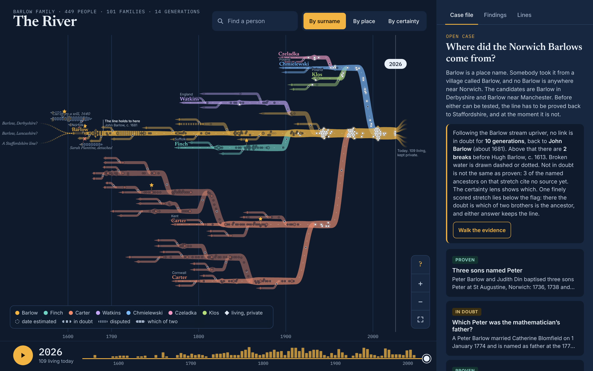

# The River

An interactive exploration of the Barlow family tree. Fourteen generations drawn as streams that join at each marriage, with a case file beside it for the one question the tree cannot yet answer: where did the Norwich Barlows come from?

Status: built and working. Data is a snapshot exported from Iris on 18 November 2026.



## Run it

```bash
npm install
```

```bash
npm run dev
```

Then open the address it prints. `npm run build` writes a static site to `dist/` that can be hosted anywhere.

## What you can do

1. **Scrub the year.** Drag the year on the river or the track below it, or press play (space bar). People light up when born and go dark when they die. The river ahead of the year is shown faintly.
2. **Tap a person.** Their record opens: dates, places, photo, sources, research notes, family. Their ancestors and descendants light up. "Follow the water" sends a pulse from them downstream to the present.
3. **Switch the lens.** By surname, by place, or by certainty (keys 1, 2, 3).
4. **Open the case file.** Nine evidence cards, ruled out, in doubt or proven. Tapping one moves the river there and lights the people and the water it bears on. "Walk the evidence" steps through them upriver.
5. **Read the findings.** Counted from the tree by rule. What it shows: the river reaches New Zealand in 1855, one couple had 14 children, 14% of people cite a record. And what is worth a second look: a parent who would have been 15, a name given twice in six families, people marked living in a generation born before 1921.
6. **Add a piece of evidence.** A draft card, saved in your browser only. It produces a change request to apply in Iris. The site never writes to the tree.

Also: search by name (`/`), zoom and pan, deep links (the address bar carries the year, person, lens and card), and a short guide behind the `?` button.

On a wide screen, play starts close on the headwaters and pulls back as the river grows. On a phone the camera travels with the year.


## How the river is drawn

This replaces the mockup's illustrative joins with real ones.

- **The river is the ancestry of the youngest generation.** Each direct ancestor's line is a stream. Each ancestral marriage is a place where two streams join, drawn at the year of the marriage. Where the marriage year is not recorded it is estimated from the first child.
- **The Barlow line is the trunk.** The other six named lines join it. Smaller springs (Din, Blomfield, Short, Julian, Seaman and about forty more) feed the line they marry into and take its colour.
- **Everyone else rides in the stream of the ancestors they descend from.** The water is as wide as the number of people alive in it that year.
- **Doubt is drawn.** Solid water has a source behind it. Dashed water is a link the tree itself calls a hypothesis. Dotted water is disputed. A flag marks how far up the trunk the evidence runs without a break: ten generations, to John Barlow the worsted weaver.
- **What was ruled out is cut off.** Ranulph Barlow's family, once thought to be Hugh's parents, sits above the river as an oxbow lake with the link crossed through.
- **Before Hugh, three guesses.** The trunk rises from three ghost headwaters: Barlow in Derbyshire, Barlow in Lancashire, or a local Staffordshire line.

## Privacy

The tree holds 109 living people. The rule is enforced when the data file is built, so nothing private ever reaches the page.

- A living person is stored as an opaque id, their links, and a position estimated from their relatives to the nearest decade. No name, date, sex, surname, place or text.
- `is_deceased` decides. A record with no flag counts as living unless it carries a date more than 120 years old.
- Marriages with a living partner have no date.
- Notes and descriptions are published only for people born before 1900 or dead before 1950, and any text that names a living person (by full name, or by a first name only living people have) is dropped.
- The raw Iris export is never committed. `data/raw/` is in `.gitignore`.

`npm test` checks all of this, including a scan of the published file for every living person's name when the raw export is present. The tests also run on every push.

What still shows: the shape of the tree. An unnamed light sits under its named, deceased parents. Decide whether that is acceptable before sharing the link beyond the family.

## Refreshing the data

1. Export the set from Iris: `export_set(set_id="4a2f4562-c930-4fb8-a2cc-0862e6f040bf", format="json")`. Save the result as `data/raw/iris-export.json`.
2. Run the build and the tests:

```bash
npm run data
```

```bash
npm test
```

3. Commit `public/data/river.json`.

The case file cards in `src/casefile.ts` are written by hand from the Iris document "Hypothesis: the original Barlow village". When that document changes, update the cards. A test fails if a card points at someone who is no longer in the tree.

## What is here

| Path | What it is |
|---|---|
| `BRIEF.md` | The original build brief |
| `pipeline/` | Iris export to `public/data/river.json`: dates, places, certainty, privacy, leads |
| `src/model/layout.ts` | The river layout: streams, confluences, widths, positions |
| `src/river.ts` | The SVG drawing and the camera |
| `src/main.ts` | The page: timeline, panels, search, deep links |
| `src/casefile.ts` | The open case: evidence cards, tests, story captions |
| `src/evidence.ts` | Draft evidence and the Iris change request |
| `tests/` | Unit tests. `npm test` |
| `scripts/smoke.cjs` | End-to-end test in a real browser. `npm run verify` runs the unit tests, builds, serves the build and runs this against it |
| `pipeline/facts.ts`, `pipeline/leads.ts` | The findings |
| `docs/data-sources.md` | Where the data lives in Iris and what shape it is in |
| `docs/council-report.md` | The Council review that chose this concept |
| `.campaign/` | The three Council reviews of this build: the plan, the first build, the iterated build |
| `mockup/` | The original static mockup |

## Not done

- Writing evidence back to Iris directly. The draft and change request are as far as it goes, on purpose.
- Photos load from Cloudinary and are only shown for the nine deceased people who have one.
- The place lens groups free-text places into ten regions. About a third of people have a recorded place. The rest take the place of a close relative and are drawn hollow.
